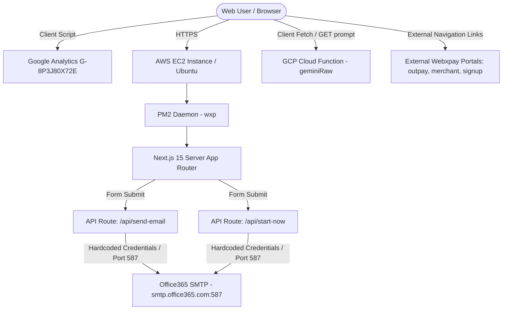
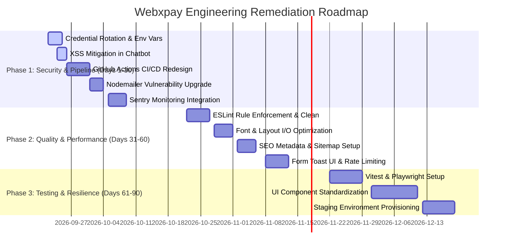

# WEBXPAY — Full Website, Codebase & Production Readiness Audit

**Target Audience:** Chief Technology Officer (CTO) & Technical Leadership  
**Date:** September 21, 2026  
**Repository:** `webxpay-it/webxpay` (`webxpay-next`)  
**Audit Scope:** Full Codebase, Next.js 15 Implementation, Security, DevOps/CI-CD, Performance, Accessibility, SEO, and Production Operations  

---

## 1. Executive Summary

WEBXPAY is a digital payments solution provider based in Sri Lanka. The audited repository (`webxpay-next`) is the company's primary customer-facing marketing website, product showcase, lead generation portal, and gateway to Webxpay's merchant portals (`signup.webxpay.com`, `merchant.webxpay.com`, `outpay.webxpay.com`, `govpay.webxpay.com`).

### Technical Condition Overview
The application is built using **Next.js 15.5.9** (App Router) on **React 19.2.3** and **TypeScript 5**. While the application visually presents a modern digital payment portal, a deep technical inspection of the source code, configurations, security mechanisms, and deployment infrastructure reveals **critical vulnerabilities, architectural flaws, and severe DevOps risks** that must be resolved before further development or production usage.

### Summary of Key Findings

| Area | Status | Major Observations |
| :--- | :--- | :--- |
| **Security** | 🔴 **CRITICAL** | Hardcoded production Office365 SMTP passwords in source code; TLS certificate verification disabled (`rejectUnauthorized: false`); Unsanitized `dangerouslySetInnerHTML` in Chatbot widget allowing XSS; Missing rate-limiting on public API endpoints. |
| **DevOps & CI/CD** | 🔴 **CRITICAL** | Production builds run directly on the live EC2 instance via SSH inside GitHub Actions; Temporary GitHub tokens stored in server Git remote; No atomic deployment or zero-downtime strategy; No rollback mechanism. |
| **Dependencies** | 🟠 **HIGH RISK** | 29 vulnerability advisories (2 Critical, 9 High) in active packages (`nodemailer`, `postcss`, `sharp`, `picomatch`). Linting rules explicitly modified to ignore unused variables and TypeScript errors. |
| **Performance** | 🟠 **HIGH RISK** | 5 separate Google Fonts loaded synchronously; Server-side `fs.existsSync` executed on every layout render; Unoptimized external scripts in `<head>`; Missing image optimization on raw `` tags. |
| **Code Quality** | 🟡 **MEDIUM** | Weak client-side input validation; Browser `alert()` used for form feedback; ESLint rules overridden to disable unused variable warnings; Copy-paste data corruption in legal text (`app/privacy-policy/page.tsx`). |
| **Architecture** | 🟡 **MEDIUM** | Inconsistent Server/Client Component boundaries (`"use client"` overused on structural components); Client-side viewport listeners controlling layout visibility instead of CSS media queries. |
| **SEO & Access** | 🟡 **MEDIUM** | Missing OpenGraph / Twitter metadata; Missing `robots.txt` and `sitemap.xml`; Missing image `alt` attributes; Inconsistent heading hierarchies. |

---

## 2. Technology Stack

The following table reflects the **exact dependencies and tools** parsed from `package.json`, `package-lock.json`, and deployment configurations.

| Layer | Technology | Version | Purpose | Current Status |
| :--- | :--- | :--- | :--- | :--- |
| **Framework** | Next.js | `^15.5.9` | Full-stack Web Framework (App Router) | Active (Up to date) |
| **UI Library** | React / React DOM | `^19.2.3` | UI Rendering Engine | Active (React 19 ecosystem) |
| **Language** | TypeScript | `^5` | Static Type Checking | Misconfigured (`strict: true` bypassed via ESLint overrides) |
| **Styling** | Tailwind CSS | `^4` | Utility-first CSS Framework | Active (`@tailwindcss/postcss`) |
| **Animations** | Framer Motion | `^12.9.4` | Component Animations | Active |
| **UI Components** | Radix UI | `^1.1.13 - 1.2.10` | Accessible Primitives (Accordion, Dialog, Sheet, Navigation) | Active |
| **Hooks Utility** | `@mantine/hooks` | `^7.17.7` | Viewport and state hooks | Misused for layout media query logic |
| **Icons** | Lucide React | `^0.507.0` | Iconography | Active |
| **Email Transporter** | Nodemailer | `^7.0.3` | Lead & Contact Form Email Delivery | 🔴 Vulnerable (High severity DoS & RFC bypass) |
| **Hosting & Infra** | AWS EC2 | Ubuntu Linux | Self-hosted Web Application Node | Active |
| **Process Manager**| PM2 | Global | Node process daemon management | Active |
| **CI/CD** | GitHub Actions | `appleboy/ssh-action@v1` | Automated deployment script | 🔴 High-risk deployment strategy |
| **External AI API** | GCP Cloud Functions | `asia-south1` | Gemini Raw AI Chatbot Backend | Active (Unauthenticated HTTP endpoint) |

---

## 3. Architecture Analysis

### Current Architecture Overview
The application follows a standard Next.js App Router layout structure hosted on a single Amazon EC2 instance behind PM2.



### Rendering & Execution Strategy
- **Server Components (RSC):** Pages (`app/page.tsx`, `app/about-us/page.tsx`, `app/pricing/page.tsx`, etc.) render statically at build time or on demand.
- **Client Components (`"use client"`):** Over-utilized across navigation (`Header`), forms (`ContactUsForm`, `StartNowField`), press carousels, and widgets (`ChatbotWidget`).
- **Data Flow:** No local database exists in `webxpay-next`. The app acts as a stateless lead generation frontend. All user-submitted data is relayed via Next.js Route Handlers to Office365 SMTP.

---

## 4. Project Structure Review

```
webxpay/
├── .github/
│   └── workflows/
│       └── deploy.yml           <-- 🔴 Hard-coded EC2 SSH pull & build pipeline
├── app/
│   ├── api/
│   │   ├── send-email/route.ts  <-- 🔴 Hardcoded credentials & unsafe TLS
│   │   └── start-now/route.ts   <-- 🔴 Hardcoded credentials & unsafe TLS
│   ├── media/
│   │   └── pressData.ts         <-- Hardcoded press release metadata array
│   ├── ChatbotWidget.tsx        <-- 🔴 Unsanitized dangerouslySetInnerHTML XSS
│   ├── globals.css
│   ├── layout.tsx               <-- 🔴 5 Google fonts, fs.existsSync overhead
│   └── page.tsx
├── components/
│   ├── aboutUs/
│   ├── common/
│   │   ├── govpay.tsx           <-- 🔴 Synchronous fs.existsSync on every render
│   │   ├── header.tsx           <-- Mantine JS viewport listener for responsive menu
│   │   └── footerAutoYear.tsx
│   ├── contact-us/
│   │   └── ContactUsForm.tsx    <-- Raw alert() UI, no loading states
│   └── ui/                      <-- Radix primitives (sheet, navigation, accordion)
├── lib/
│   └── utils.ts                 <-- clsx + tailwind-merge helper
├── public/                      <-- Unorganized static assets (~170 files)
├── eslint.config.mjs            <-- 🔴 Disabled unused-vars & ts-ignore rules
├── next.config.ts               <-- Basic Next.js configuration
├── package.json
└── tsconfig.json
```

### Key Structural Issues
1. **Misplaced Server I/O in Components:** `components/common/govpay.tsx` imports Node.js `fs` and `path` to check if `/common/crypto-logo.png` exists on disk during layout rendering.
2. **Duplicate Code in API Routes:** `app/api/send-email/route.ts` and `app/api/start-now/route.ts` contain identical, duplicated Nodemailer transport initialization logic and error handling.
3. **Unorganized Public Directory:** `public/common/` contains outdated, duplicated, and redundant image files (`bill-payment-icon.ico`, `bill-payments-final.jpg`, `bill-payments-vecteezy.jpg`, `bill-payments-mobile.png`).
4. **Copy-Paste Corruption in Content:** `app/privacy-policy/page.tsx` contains repeated, malformed paragraphs appended with broken URL fragments (`://www.facebook.com/policy.php...`).

---

## 5. Security Audit

### 🔴 Critical Security Vulnerabilities

#### 1. Hardcoded Production Credentials in Source Code
- **Severity:** 🔴 **CRITICAL**
- **Location:**  
  - [app/api/send-email/route.ts:22-23](file:///d:/webxpay/app/api/send-email/route.ts#L22-L23)  
  - [app/api/start-now/route.ts:22-23](file:///d:/webxpay/app/api/start-now/route.ts#L22-L23)
- **Code Evidence:**
  ```typescript
  user: process.env.EMAIL_USER || 'leads@webxpay.com',
  pass: process.env.EMAIL_PASS || 'wxp@2025'
  ```
- **Risk & Attack Scenario:** Anyone with access to the source code repository (including past developers, contractors, or compromised CI runners) has the plaintext credentials for `leads@webxpay.com` on Office365 (`wxp@2025`). An attacker can log into Office365, read confidential lead emails, or send spear-phishing emails from the official corporate domain.
- **Remediation:** Immediately change the password for `leads@webxpay.com` in Office365. Remove fallback credentials from the codebase and enforce mandatory environment variables (`process.env.EMAIL_PASS`) with build-time assertions.

---

#### 2. Disabled TLS Certificate Verification (`rejectUnauthorized: false`)
- **Severity:** 🔴 **CRITICAL**
- **Location:**  
  - [app/api/send-email/route.ts:27](file:///d:/webxpay/app/api/send-email/route.ts#L27)  
  - [app/api/start-now/route.ts:27](file:///d:/webxpay/app/api/start-now/route.ts#L27)
- **Code Evidence:**
  ```typescript
  tls: {
      ciphers: 'TLSv1.2',
      rejectUnauthorized: false
  }
  ```
- **Risk & Attack Scenario:** Disabling `rejectUnauthorized` instructs Node.js to accept ANY SSL/TLS certificate, even invalid, expired, or self-signed ones. A Man-In-The-Middle (MITM) attacker on the network path between the EC2 server and Office365 can intercept, decrypt, and manipulate contact form communications and credentials in transit.
- **Remediation:** Remove `rejectUnauthorized: false`. Valid corporate mail providers like Office365 supply valid, trusted SSL certificates.

---

#### 3. Cross-Site Scripting (XSS) via Unsanitized `dangerouslySetInnerHTML`
- **Severity:** 🔴 **CRITICAL**
- **Location:** [app/ChatbotWidget.tsx:173-176](file:///d:/webxpay/app/ChatbotWidget.tsx#L173-L176)
- **Code Evidence:**
  ```typescript
  <div
      key={index}
      className={`cw-message ${msg.sender === "user" ? "cw-user" : "cw-bot"}`}
      dangerouslySetInnerHTML={{
          __html: msg.sender === "bot" ? renderMarkdown(msg.text) : msg.text,
      }}
  />
  ```
- **Risk & Attack Scenario:** The AI Chatbot fetches data from an external GCP endpoint (`https://asia-south1-chatbotweb-478005.cloudfunctions.net/geminiRaw`). The response text is passed into `renderMarkdown()`, which performs simple regex replacements for links and bolding, but does NOT strip HTML tags (`<script>`, `<iframe onload=...>`, ``). If the external endpoint is compromised or returns prompt-injected script tags, the script will execute directly in the customer's browser.
- **Remediation:** Pass all formatted HTML through DOMPurify (`isomorphic-dompurify`) before rendering, or replace raw HTML injection with a structured React markdown renderer (`react-markdown`).

---

#### 4. HTML Template Injection & Missing Input Validation in Email Endpoints
- **Severity:** 🟠 **HIGH**
- **Location:**  
  - [app/api/send-email/route.ts:49-75](file:///d:/webxpay/app/api/send-email/route.ts#L49-L75)  
  - [app/api/start-now/route.ts:45-56](file:///d:/webxpay/app/api/start-now/route.ts#L45-L56)
- **Code Evidence:**
  ```typescript
  <td style="border: 1px solid #ddd; padding: 8px;">${name}</td>
  <td style="border: 1px solid #ddd; padding: 8px;">${email}</td>
  ```
- **Risk & Attack Scenario:** Form values (`name`, `email`, `company`, `message`) are concatenated directly into the HTML string sent via email. An attacker can inject arbitrary HTML markup or payload links into emails sent to internal Webxpay staff, leading to internal client-side phishing or email client distortion.
- **Remediation:** Sanitize user input using an HTML entity escaper (`he.encode()` or standard string replacements) prior to template string insertion.

---

#### 5. Lack of API Rate Limiting & Bot Protection
- **Severity:** 🟠 **HIGH**
- **Location:** `app/api/send-email/route.ts`, `app/api/start-now/route.ts`
- **Risk:** Public POST endpoints have no rate limiting, CAPTCHA, or IP throttling. Bots can spam these endpoints continuously, exhausting Office365 email quotas, triggering SMTP account suspensions, or flooding internal sales teams.
- **Remediation:** Implement rate limiting middleware (e.g., `@upstash/ratelimit` or Next.js edge rate limiters) and integrate Google reCAPTCHA v3 or Cloudflare Turnstile on lead forms.

---

## 6. Code Quality & Standards Audit

### ESLint Rules Suppressed to Hide Quality Deficiencies
Inspection of [eslint.config.mjs](file:///d:/webxpay/eslint.config.mjs) shows explicit rule suppressions designed to bypass code quality checks:
```javascript
rules: {
    '@typescript-eslint/no-unused-vars': 'off',
    '@typescript-eslint/ban-ts-comment': ['off', {tsIgnore: 'allow'}],
    '@next/next/no-sync-scripts': 'off'
}
```
- **Impact:** Developers explicitly disabled warnings for unused variables, allowed unsafe `@ts-ignore` comments, and permitted synchronous `<script>` tags that degrade page performance.

### Specific Code Deficiencies

| File / Location | Code Snippet / Pattern | Issue & Impact | Recommended Fix |
| :--- | :--- | :--- | :--- |
| `components/contact-us/ContactUsForm.tsx:16` | `alert('Please fill in all fields.');` | Native browser `alert()` blocks UI thread and provides unprofessional UX. | Replace with accessible toast notifications (`sonner` or `react-hot-toast`). |
| `components/contact-us/ContactUsForm.tsx:3` | `import React, {useEffect, useState} from 'react';` | `useEffect` imported but never used. | Remove unused import. Re-enable `@typescript-eslint/no-unused-vars`. |
| `components/contact-us/ContactUsForm.tsx` | Form submission button | No loading state or `disabled` prop during async fetch. Allows double-submits. | Track `isSubmitting` state and disable submit button while pending. |
| `app/privacy-policy/page.tsx:146` | `"...illegal activity that may eXPOSe us..."` | Text corruption: Brand name "XPOS" accidentally substituted into legal text. | Correct text to "expose us". |
| `app/privacy-policy/page.tsx:148, 150` | `"...at any time.://www.facebook.com/policy.php..."` | Malformed copy-paste junk URL appended to multiple paragraphs. | Clean up content formatting in Privacy Policy page. |
| `components/common/header.tsx:26-31` | `useViewportSize()` JS listener | Listens to window resizing via JS to toggle mobile navigation menu. | Replace JS event listeners with CSS media queries (`hidden lg:flex`). |

---

## 7. Next.js Implementation Deep Audit

### App Router Architecture Assessment
- **Layouts & Metadata:** Root layout (`app/layout.tsx`) sets a global title and description. However, **individual page routes lack dedicated metadata objects** (e.g., `app/solutions/page.tsx`, `app/pricing/page.tsx`, `app/contact-us/page.tsx` do not export custom `Metadata`).
- **Missing Error Boundaries:** No `app/error.tsx` or `app/global-error.tsx` exists. If any React component throws an unhandled client runtime exception, the entire page crashes to an unstyled browser error screen.
- **Missing Not-Found Handler:** No `app/not-found.tsx` exists to render a branded 404 page when users hit invalid URLs.
- **Image Optimization Gaps:** `ChatbotWidget.tsx` uses a raw `` tag (``) instead of Next.js `<Image />`, causing unoptimized asset loading and triggering ESLint warnings.

---

## 8. Performance Audit

### Performance Risks & Bottlenecks

#### 1. Heavy Font Loading Overhead
In [app/layout.tsx:4-33](file:///d:/webxpay/app/layout.tsx#L4-L33), 5 separate Google Fonts are loaded into CSS variables:
1. `Geist`
2. `Geist_Mono`
3. `Manrope`
4. `Sora`
5. `Space_Grotesk`

- **Impact:** Each font requests multiple WOFF2 font files over network connections, impacting render-blocking performance, Cumulative Layout Shift (CLS), and Interaction to Next Paint (INP).
- **Remediation:** Standardize typography to 1 or 2 primary font families (e.g., `Manrope` for body and `Space_Grotesk` for headers).

---

#### 2. Synchronous Server I/O during Render
In [components/common/govpay.tsx:18](file:///d:/webxpay/components/common/govpay.tsx#L18):
```typescript
const hasCryptoIcon = fs.existsSync(path.join(process.cwd(), "public", "common", "crypto-logo.png"));
```
- **Impact:** `Govpay` is imported directly into `app/layout.tsx`. On every incoming request, Node.js performs a synchronous file system check (`fs.existsSync`) to confirm if a file exists in the public directory.
- **Remediation:** Remove `fs.existsSync`. Asset availability should be known at compile time or managed statically without runtime disk inspection.

---

#### 3. Unoptimized External Script Placement
In [app/layout.tsx:50-61](file:///d:/webxpay/app/layout.tsx#L50-L61): Google Analytics (`gtag.js`) is loaded with `strategy="beforeInteractive"` inside the layout body. `beforeInteractive` scripts block page hydration until the external script completes downloading.
- **Remediation:** Change loading strategy to `strategy="afterInteractive"` or `strategy="lazyOnload"`.

---

## 9. Mobile & Responsive Design Audit

### Key Responsive Design Gaps
1. **JavaScript-Driven Breakpoint Logic:** `components/common/header.tsx` uses `@mantine/hooks` (`useViewportSize`) to close the mobile drawer when viewport width exceeds 1024px. Using JS event listeners for layout state creates hydration mismatches and unnecessary re-renders during window resizing.
2. **Hardcoded Component Widths:** In `components/solutions/home/items/SolutionDetailCard.tsx` and chatbot panel (`ChatbotWidget.tsx`), fixed pixel widths (`width: 380px`) cause horizontal overflow or clipping on smaller mobile viewports (e.g., iPhone SE at 320px-365px width).
3. **Fixed Floating Action Stack:** `components/common/govpay.tsx` renders floating action buttons (`govpay`, `bill-payment`, `bank-transfer`, `crypto`) with fixed pixel sizes (`h-[72px] w-[72px]`). On smaller mobile devices, this stack occupies significant screen real estate, obscuring page content and floating chat widgets.

---

## 10. UI/UX Implementation Review

1. **Inconsistent Component Library Usage:** The project installs Radix UI (`accordion`, `dialog`, `sheet`, `navigation-menu`), but custom UI elements elsewhere rely on ad-hoc Tailwind utility classes or custom inline CSS (`Parallelogram.css`, `ChatbotWidget.tsx` `<style jsx global>`).
2. **Poor Feedback & Form States:** Forms in `ContactUsForm.tsx` and `StartNowField.tsx` lack disabled states, pending indicators, or success toasts. Users clicking submit receive native browser `alert()` popups.

---

## 11. Accessibility Audit (a11y)

| Severity | Issue Description | Affected Files / Components | Impact |
| :--- | :--- | :--- | :--- |
| **High** | Empty / Decorative `alt` text missing | `components/common/govpay.tsx:30` (`alt=""`), `components/common/header.tsx:217` | Screen readers cannot convey button purpose. |
| **Medium** | Non-semantic Interactive Elements | `components/common/header.tsx:117` (`<div onClick=...>`) | Clickable `div` elements are not keyboard focusable (`tabindex`) and lack ARIA roles. |
| **Medium** | Missing Form Input Labels | `components/home/StartNowField.tsx:45` | `<input>` relies solely on `placeholder` without explicit `<label>` or `aria-label`. |
| **Low** | Inconsistent Heading Hierarchy | `app/privacy-policy/page.tsx` | Skips `<h2>` levels, moving directly from `<h1>` to `<h3>` and styled `<p>` text. |

---

## 12. SEO Audit

1. **Missing Open Graph & Social Cards:** `app/layout.tsx` defines basic `title` and `description`, but lacks `openGraph` (`og:image`, `og:title`, `og:type`) and `twitter` card metadata. Social links shared on WhatsApp, LinkedIn, or Twitter will not display rich preview cards.
2. **Missing Canonical URLs:** No canonical URL tags exist in metadata, creating risk of duplicate content indexing.
3. **Missing `sitemap.xml` and `robots.txt`:** The repository contains no `app/sitemap.ts` or `app/robots.ts`. Search engine crawlers have no explicit guidance on indexing rules or priority routes.

---

## 13. Dependency & Package Audit

Running `npm audit` against `package-lock.json` identified **29 security vulnerabilities**:

```
Vulnerability Overview:
- Critical: 2
- High: 9
- Moderate: 18
Total: 29
```

### Notable Vulnerable Packages

1. **Nodemailer (`^7.0.3` installed / lockfile version vulnerable):**
   - **GHSA-2x7j-588g-ccc2 (High Severity):** Quadratic time complexity leading to Denial of Service via crafted email addresses.
   - **GHSA-cc9r-2j5m-2m83 (Moderate Severity):** Recipient domain validation bypass allowing email delivery to unauthorized domains.
2. **PostCSS / Next.js Internal PostCSS:**
   - **GHSA-6g55-p6wh-862q (High Severity):** Path traversal and arbitrary file disclosure via source map comments.
3. **Sharp (`sharp` graphics library):**
   - **GHSA-f88m-g3jw-g9cj (High Severity):** Buffer overflow and memory safety issues in underlying C libraries (`libvips`/`libheif`).

---

## 14. API & External Integration Audit

| Integration | Endpoint / Target | Authentication | Fail-Safe / Fallback | Identified Risk |
| :--- | :--- | :--- | :--- | :--- |
| **Office365 SMTP** | `smtp.office365.com:587` | Hardcoded Username/Password | None (Returns 500 JSON error) | Hardcoded password in code; `rejectUnauthorized: false` allows MITM. |
| **GCP Gemini AI** | `https://asia-south1-chatbotweb-478005.cloudfunctions.net/geminiRaw` | Unauthenticated HTTP GET | Fallback text string | Endpoint URL exposed in JS bundle; No rate limiting; Responses inserted unsanitized into DOM. |
| **Merchant Signup** | `https://signup.webxpay.com/wbx-merchant-signup` | N/A (External Link) | N/A | External navigation; correctly uses `rel="noopener noreferrer"`. |
| **Merchant Portal** | `https://merchant.webxpay.com/` | N/A (External Link) | N/A | External navigation link. |
| **Outpay Portal** | `https://outpay.webxpay.com/...` | N/A (External Link) | N/A | Direct links to external transaction forms (`fund-transfer`, `bill-payment`). |

---

## 15. Payment Security & PCI DSS Scope Analysis

Because WEBXPAY is a financial payment gateway provider, customer trust and regulatory compliance (PCI DSS) are paramount.

### PCI DSS Scope Assessment
- **Cardholder Data Handling:** The `webxpay-next` codebase **does not collect, process, or store credit card numbers directly**. All payment buttons (`Sign up`, `Log in`, `GovPay`, `Outpay`) redirect users to dedicated subdomains (`signup.webxpay.com`, `outpay.webxpay.com`, `merchant.webxpay.com`).
- **Scope Boundary:** `webxpay-next` is classified as a **marketing website redirector**. Under PCI DSS SAQ A, redirecting websites must ensure that the redirection mechanism cannot be compromised (e.g., via XSS or DNS hijacking) to redirect merchants or buyers to malicious phishing destinations.
- **Identified Compliance Risk:** The XSS vulnerability in `ChatbotWidget.tsx` and hardcoded SMTP credentials compromise the integrity of the origin server hosting the redirect links, presenting a secondary PCI compliance risk for SAQ A compliance.

---

## 16. Error Handling & Reliability

1. **No Application-Level Catch-All:** Absence of `app/error.tsx` means React component runtime crashes bubble up directly to unhandled error states.
2. **Silent Console Errors:** API routes log errors directly to server stdout via `console.error` without structured metadata or external alerting.
3. **No Fallback UI for External Services:** If the GCP Chatbot function fails or times out, the client widget retries blindly without exponential backoff.

---

## 17. Logging, Monitoring & Observability

- **Current Status:** ❌ **NONE**.
- **Observations:** The repository has zero integration with error monitoring platforms (e.g., Sentry, Datadog, LogRocket, or AWS CloudWatch Insights).
- **Impact:** System crashes, failed email transmissions, and client-side JavaScript errors occur completely silently in production without technical notification to the engineering team.

---

## 18. Testing Audit

- **Current Test Coverage:** **0%**
- **Test Infrastructure:** Zero test files (`*.test.ts`, `*.spec.ts`), zero testing frameworks (`Jest`, `Vitest`, `Playwright`, `Cypress`), and zero test scripts in `package.json`.
- **Risk:** Any pull request or code change pushed to `main` is deployed directly to production without running unit, integration, or smoke tests.

---

## 19. CI/CD & GitHub Actions Audit

Inspect [`.github/workflows/deploy.yml`](file:///d:/webxpay/.github/workflows/deploy.yml):

```yaml
name: Deploy Next.js to EC2

on:
  push:
    branches:
      - main

jobs:
  deploy:
    runs-on: ubuntu-latest
    steps:
      - name: Deploy to EC2 via SSH
        uses: appleboy/ssh-action@v1
        with:
          host: ${{ secrets.EC2_HOST }}
          username: ${{ secrets.EC2_USER }}
          key: ${{ secrets.SSH_PRIVATE_KEY }}
          script: |
            set -e
            cd /home/ubuntu/webxpay
            git remote set-url origin https://x-access-token:${{ github.token }}@github.com/${{ github.repository }}.git
            git fetch origin main
            git checkout main
            git reset --hard origin/main
            git remote set-url origin https://github.com/${{ github.repository }}.git
            rm -rf .next
            npm ci
            npm run build
            pm2 restart wxp --update-env || pm2 start npm --name "wxp" -- start
```

### Critical DevOps Vulnerabilities in Deployment Pipeline

1. **Production Build Ran on Live Server:** `npm run build` runs directly on the single EC2 production instance. Executing CPU-intensive Next.js compilation on a live server spikes CPU usage to 100% and consumes RAM, causing site slowdowns, dropped HTTP requests, or server freezing during deployments.
2. **Temporary Token Injection into Git Remote:** Line 29 mutates the production server's Git configuration with `x-access-token:${{ github.token }}`. If the SSH script fails mid-execution before line 37 executes, the short-lived GitHub deployment token remains saved on the server disk in `.git/config`.
3. **No Rollback Capability:** `rm -rf .next` deletes the existing working build before starting the new build. If `npm run build` fails due to a syntax or dependency error, the live production site goes completely down with no previous build available for rollback.
4. **No Health Checks or Smoke Verification:** The pipeline terminates immediately after triggering PM2 without verifying whether the HTTP server is responding with a `200 OK`.

---

## 20. AWS / Server Deployment Review

- **Current Infrastructure:** Single standalone AWS EC2 instance running Ubuntu, Node.js, and PM2.
- **Single Point of Failure:** Operating a single EC2 instance without an Application Load Balancer (ALB), Auto Scaling Group, or multi-AZ setup means hardware failure or OS updates result in 100% site downtime.
- **Reverse Proxy Gaps:** No Nginx or Cloudflare reverse proxy configuration is present in the repository, implying PM2/Node.js directly handles incoming traffic or relies on unmanaged external setup.

---

## 21. Configuration Audit

- **`next.config.ts`:** Minimal configuration. Custom image domains are missing; security headers are omitted.
- **`tsconfig.json`:** Set to `"strict": true`, but effectively bypassed by ESLint rule suppressions.
- **`package.json` Engines:** Correctly specifies `"node": ">=20.9 <24"`.

---

## 22. Database & Data Handling

- **Database:** None. The application operates completely statelessly.
- **Data Risk:** User inputs collected via form endpoints are converted to plain text/HTML emails and transmitted over SMTP.

---

## 23. Production Readiness Assessment

Evaluation across 10 core operational engineering dimensions (Rated 1-10):

```
Security & Secrets       [█░░░░░░░░░]  1/10  (Critical vulnerabilities & hardcoded secrets)
DevOps & CI/CD           [██░░░░░░░░]  2/10  (In-place server builds, no rollbacks)
Observability & Logging  [█░░░░░░░░░]  1/10  (Zero monitoring or error tracking)
Test Automation          [░░░░░░░░░]  0/10  (Zero unit/e2e test coverage)
Performance              [█████░░░░░]  5/10  (Heavy font load & layout fs checks)
Architecture & Code Quality[█████░░░░░]5/10  (Mixed RSC boundaries, suppressed linter)
SEO & Metadata           [████░░░░░░]  4/10  (Missing OpenGraph cards & sitemaps)
Accessibility (a11y)     [████░░░░░░]  4/10  (Missing alt text & aria labels)
Documentation            [███░░░░░░░]  3/10  (Basic README, missing setup details)
Reliability              [███░░░░░░░]  3/10  (No error boundaries or fallback UIs)

Overall Production Readiness Score: 2.7 / 10 (NOT PRODUCTION READY)
```

---

## 24. Technical Debt Register

| ID | Issue | Area | Severity | Business Impact | Engineering Effort | Recommended Action |
| :--- | :--- | :--- | :--- | :--- | :--- | :--- |
| **TD-01** | Hardcoded SMTP Passwords | Security | 🔴 Critical | Unauthorized access to corporate email & lead spoofing | 1 hour | Move credentials to EC2 environment variables & AWS Secrets Manager. |
| **TD-02** | Unsanitized Chatbot HTML | Security | 🔴 Critical | Cross-Site Scripting (XSS) on customer browsers | 2 hours | Wrap chatbot markdown output in DOMPurify. |
| **TD-03** | In-place EC2 CI/CD Build | DevOps | 🔴 Critical | CPU spikes and downtime during every code deployment | 1 day | Update GitHub Actions to build standalone artifacts on runner and push to EC2. |
| **TD-04** | Suppressed ESLint Rules | Quality | 🟠 High | Accumulation of silent bugs and dead code | 3 hours | Remove overrides in `eslint.config.mjs` and resolve reported lint errors. |
| **TD-05** | Synchronous `fs` in Layout | Performance | 🟡 Medium | I/O latency on every server render | 30 mins | Remove `fs.existsSync` from `govpay.tsx`. |
| **TD-06** | 5 Google Fonts Loading | Performance | 🟡 Medium | High LCP/CLS render-blocking delays | 2 hours | Consolidate fonts to `Manrope` and `Space_Grotesk` in `layout.tsx`. |
| **TD-07** | Copy-Paste Privacy Policy Bugs | Content | 🟡 Medium | Brand damage and legal formatting issues | 1 hour | Fix copy corruption and typos in `privacy-policy/page.tsx`. |

---

## 25. Risk Matrix

| Risk | Probability | Impact | Severity | Evidence | Mitigation |
| :--- | :--- | :--- | :--- | :--- | :--- |
| **Corporate Email Compromise** | High | Critical | 🔴 Critical | Plaintext password `wxp@2025` in `route.ts` | Rotate password immediately; enforce env vars. |
| **Deployment Server Freeze** | High | High | 🔴 Critical | `npm run build` executed on live EC2 server | Build on CI runner; transfer output bundle. |
| **XSS Attack via Chatbot** | Medium | Critical | 🔴 Critical | Unsanitized `dangerouslySetInnerHTML` | Sanitize all HTML strings before rendering. |
| **Email API Spam & DoS** | High | Medium | 🟠 High | No rate-limiting on `/api/send-email` | Implement Upstash rate limiting & reCAPTCHA. |
| **Silent Production Failure** | High | High | 🟠 High | 0 error tracking tools installed | Integrate Sentry for Next.js error monitoring. |

---

## 26. Prioritized Action Plan

### P0 — Immediate / Critical (Fix Within 48 Hours)
1. **Rotate & Secure Credentials:**
   - Immediately change Office365 password for `leads@webxpay.com`.
   - Update `app/api/send-email/route.ts` and `app/api/start-now/route.ts` to require `process.env.EMAIL_PASS` without fallback defaults.
   - Re-enable TLS certificate validation (`rejectUnauthorized: true`).
2. **Sanitize Chatbot HTML Output:**
   - Install `isomorphic-dompurify`.
   - Sanitize all strings before passing into `dangerouslySetInnerHTML` in `ChatbotWidget.tsx`.
3. **Fix GitHub Actions Deployment:**
   - Update `.github/workflows/deploy.yml` to build Next.js output on the GitHub Actions runner, tar the output, and deploy to EC2 without running `npm run build` on the live instance.

---

### P1 — High Priority (Fix Within 14 Days)
1. **Remediate Package Vulnerabilities:** Run `npm audit fix` and upgrade `nodemailer` to `>=9.1.0`.
2. **Restore ESLint Quality Standards:** Remove rule overrides in `eslint.config.mjs` and clean up unused variables.
3. **Add Rate Limiting & CAPTCHA:** Protect public API routes against automated spam.
4. **Setup Sentry Error Monitoring:** Install `@sentry/nextjs` to catch production runtime exceptions.

---

### P2 — Medium Priority (Fix Within 30 Days)
1. **Optimize Layout & Fonts:** Consolidate to 2 font families; remove `fs.existsSync` from layout execution path.
2. **Implement SEO Essentials:** Add `app/sitemap.ts`, `app/robots.ts`, and OpenGraph metadata to root layout.
3. **Add Root Error Boundaries:** Create `app/error.tsx` and `app/not-found.tsx`.
4. **Fix Privacy Policy Content:** Clean up text corruption in `app/privacy-policy/page.tsx`.

---

### P3 — Improvements (Fix Within 60 Days)
1. **Introduce Automated Testing:** Set up Vitest/React Testing Library and Playwright for core user journey validation.
2. **Design System Standardization:** Replace ad-hoc CSS files with standard Tailwind UI primitives.
3. **Form UI Polish:** Replace browser `alert()` popups with toast notifications.

---

## 27. 30 / 60 / 90 Day Engineering Roadmap



---

## 28. CTO Decision Summary

### Architecture Assessment
The current architecture is a lightweight, stateless marketing website built on Next.js 15. The core framework choice is sound and capable of handling Webxpay's growth, but the **implementation suffers from severe operational shortcuts and security oversights**.

### Main Technical Strengths
- Built on modern, up-to-date versions of **Next.js 15**, **React 19**, and **Tailwind CSS 4**.
- Fast initial page generation using Next.js App Router Server Components.
- Clean presentation layer with Radix UI and Framer Motion animations.

### Main Technical Weaknesses
- **Critical security flaws:** Hardcoded production email passwords and unsanitized HTML injection.
- **Unsafe DevOps pipeline:** Production builds execute directly on the live server via SSH.
- **Zero test coverage and zero monitoring:** Failures occur unobserved in production.

### Decisions Required From CTO

1. **Secrets Management:** Authorize moving production credentials into AWS Secrets Manager or secure EC2 environment variables immediately.
2. **CI/CD Infrastructure:** Approve refactoring the deployment pipeline to build artifacts on GitHub Actions runners rather than on the production EC2 server.
3. **Observability Budgeting:** Approve integration of Sentry (Free/Developer tier sufficient initially) for automated exception tracking.
4. **Process Enforcement:** Require all future code changes to pass mandatory `npx tsc --noEmit` and `npx eslint .` checks prior to merging PRs.
